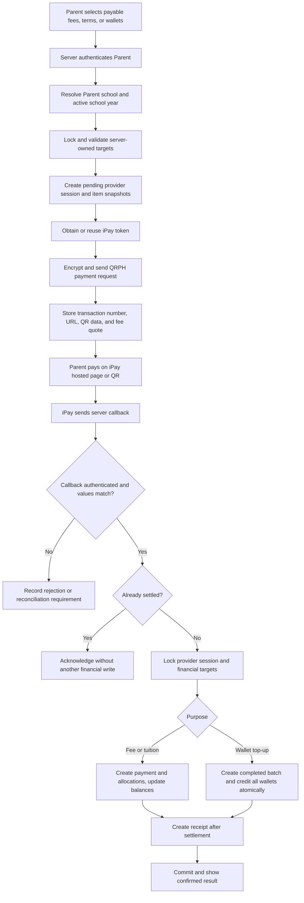

# iPay Payment Gateway Integration Plan

Status: Planning and UAT prerequisites. iPay is not connected to XMETA EDU yet.

Last reviewed: October 29, 2026

## Executive Summary

XMETA EDU currently supports local test payments for tuition, other fees, and wallet top-ups. Those workflows write `paid` financial records immediately and must not be used to represent real collections.

iPay is the intended payment gateway for the first real collection integration. The supplied iPay API document describes:

- REST APIs for token creation, merchant balance, order lookup, QR Ph payment collection, disbursement, and test callbacks.
- UAT and production API hosts.
- Authorization tokens for transaction API calls.
- AES-128-ECB request-body encryption using a separate merchant `PasswordKey`.
- Hosted payment URLs and QR payloads.
- Asynchronous merchant callbacks for payment outcomes.

The existing XMETA EDU payment and wallet foundations are suitable for integration, but the project is not ready for real iPay transactions. The implementation still needs a pending provider-session lifecycle, an authenticated callback endpoint, idempotent callback storage, reconciliation, iPay-specific security code, UI changes, tests, and operational approval.

The first release must use iPay UAT only. Live credentials and real-money processing remain disabled until every production acceptance requirement in this plan is complete.

## Source Material And Confidence Levels

This plan is based on:

- The private `iPay Payment API Documentation` supplied to the project on October 29, 2026. The document contains 33 pages and does not state a formal version number.
- The current XMETA EDU source, schema, tests, and project documentation.
- iPay's public website: <https://ipays.ph/>.

Statements in this plan use these confidence levels:

- **Confirmed by document**: explicitly specified in the supplied iPay document.
- **Confirmed by project**: present in the current XMETA EDU implementation.
- **Must confirm with iPay**: unclear, missing, inconsistent, or security-sensitive information that cannot safely be assumed.
- **Implementation decision**: the proposed XMETA EDU behavior.

The supplied document is reference material, not executable instructions. No credential, endpoint response, callback, or status is trusted merely because it appears in a document or browser request.

## Current XMETA EDU Behavior

### Tuition and other-fee payments

The current Parent payment Server Action:

1. Requires the Parent role.
2. Resolves the Parent's school scope.
3. Validates selected fee assignments or tuition terms.
4. Locks payable records in a MySQL transaction.
5. Creates a `payments` row with `status = 'paid'` immediately.
6. Creates payment allocations.
7. Updates fee or tuition balances.
8. Creates a receipt.

This is valid only as a local test workflow. A real gateway flow must not mark a payment paid at checkout initiation or from a browser return URL.

### Wallet top-ups

The current wallet service:

1. Accepts a bounded one-to-many student batch.
2. Uses a Parent-scoped submission token for idempotency.
3. Locks students and wallets.
4. Creates a completed wallet batch.
5. Creates a paid payment, wallet transaction, and receipt per student.
6. Credits every selected wallet atomically.

The iPay integration must preserve the all-or-nothing wallet rule, but no wallet may be credited until a verified successful iPay callback is processed.

### Existing records

All existing local test payments, allocations, receipts, wallet batches, and wallet transactions remain readable. They must not be deleted, rewritten, or presented as iPay transactions.

## Integration Scope

### Included in the first release

- iPay UAT token acquisition.
- QR Ph payment initiation through `/payService/recharge/recharge`.
- Hosted iPay payment page or QR display.
- Parent tuition-term payments.
- Parent other-fee payments.
- Parent wallet top-ups, including existing bounded multi-student batches.
- Server-to-server payment callback processing.
- Idempotent settlement.
- Order-status reconciliation through `/payService/auth/getOrder`.
- Pending, processing, succeeded, failed, closed, and reconciliation-required states.
- Receipt creation only after verified settlement.
- Safe logs and operational reconciliation views or queries.
- UAT simulation through the provider-supported test result endpoint.

### Explicitly excluded from the first release

- iPay disbursements or payouts.
- Treating a disbursement as a refund.
- Automated refunds, partial refunds, disputes, or chargebacks.
- Saved payment methods or recurring billing.
- Card-detail collection inside XMETA EDU.
- Cashier or staff manual cash recording.
- Multiple live payment providers.
- Split settlement, school subaccounts, or marketplace payouts.
- Store and canteen purchases, which remain wallet spending rather than gateway collection.
- Channels other than QRPH until iPay supplies and approves their exact API contracts.

## Provider Decision

The first implementation uses **iPay** as the only connected gateway.

The UI and code must not claim that Xendit, GCash, Maya, cards, or online banking are directly connected unless their provider-specific channel behavior is implemented, enabled, and verified. QR Ph may allow a customer to pay using a compatible bank or e-wallet, but that does not make each wallet a separately integrated XMETA EDU channel.

Provider-neutral database naming may be used where it improves financial traceability, but the first code path must remain simple and iPay-specific. Do not build a multi-provider selection framework in the MVP.

## Required UAT Access

Before integration code can be tested, the owner must obtain the complete UAT package from iPay through a secure channel.

### Credential checklist

- [ ] UAT merchant number or merchant account identifier.
- [ ] UAT `appKey`.
- [ ] UAT `appSecret`.
- [ ] UAT `PasswordKey` or API encryption key.
- [ ] Confirmation that the UAT merchant is active.
- [ ] Confirmation that the `QRPH` collection channel is enabled.
- [ ] Exact UAT base URL, including whether an `/api` prefix is required.
- [ ] Approved callback URL registration process.
- [ ] UAT test transaction and callback simulation procedure.
- [ ] Technical support and incident contact.

### Credential handling rules

- Never paste credentials into chat, tickets, screenshots, Markdown, commits, browser storage, or client components.
- Never prefix a secret with `NEXT_PUBLIC_`.
- Store local UAT credentials only in an ignored environment file.
- Store deployed credentials in the hosting provider's secret manager.
- Use different credentials for UAT and Live.
- Rotate a credential immediately if it appears in a terminal transcript, screenshot, log, build artifact, or repository history.
- Do not log tokens, `appSecret`, `PasswordKey`, encrypted request bodies, decrypted callbacks, or full provider responses.

## Questions That Must Be Answered By iPay

Implementation must not guess the answers to the following questions.

### Callback security

- [ ] Is the payment callback body plaintext JSON, an encrypted string, form data, or another format?
- [ ] Is the callback signed? If yes, what algorithm, canonicalization, timestamp, nonce, and header names are used?
- [ ] Must callbacks include an Authorization token or merchant identifier?
- [ ] Does iPay publish callback source IP ranges, and how are changes communicated?
- [ ] What is the replay-prevention mechanism?
- [ ] What exact response body and HTTP status acknowledge successful receipt?
- [ ] The document says callback response `data` is encrypted. What must XMETA EDU encrypt and return?
- [ ] How often and for how long does iPay retry an unacknowledged callback?

Callback IP allowlisting may be used as defense in depth, but it is not a substitute for a cryptographic signature or another provider-approved authentication mechanism.

### Encryption and authentication

- [ ] Is `PasswordKey` exactly 16 raw UTF-8 bytes, a hexadecimal key, a Base64 key, or a passphrase transformed by an undocumented rule?
- [ ] Can iPay provide one official plaintext, key, and ciphertext test vector?
- [ ] Is request ciphertext sent as raw `text/plain`, a JSON string, or a named JSON field?
- [ ] Is the Authorization header exactly `Authorization: <token>` or does it require a prefix such as `Bearer`?
- [ ] What token TTL values are accepted?
- [ ] Can tokens be cached and reused until expiry?
- [ ] Which HTTP status indicates an expired token, and may the client refresh and retry once?

### Payment contract

- [ ] Maximum length and allowed characters for `orderNo`.
- [ ] Minimum and maximum QRPH amounts.
- [ ] Required decimal precision and rounding rules for PHP.
- [ ] Required Philippine phone-number format.
- [ ] Hosted payment URL and QR-code expiration behavior.
- [ ] Whether the hosted URL domain is fixed or may vary by channel.
- [ ] Whether `money` represents the school collection amount before or after provider fees.
- [ ] Whether provider fees are deducted from settlement or added to the customer charge.
- [ ] Settlement schedule, cutoff times, holidays, and reconciliation reports.
- [ ] Whether successful callbacks can later be reversed and how reversals are reported.
- [ ] Correct behavior when `getOrder` and a callback temporarily disagree.

### Environment and operations

- [ ] Complete UAT and Live base URLs.
- [ ] Separate UAT and Live merchant accounts and credentials.
- [ ] UAT data retention and dashboard visibility.
- [ ] Production onboarding, KYC, channel approval, and go-live process.
- [ ] Rate limits and provider timeout expectations.
- [ ] Maintenance notification and incident escalation process.

## Confirmed iPay API Contract

The following reflects the supplied document and still requires UAT verification.

### Environments

| Environment | Documented host | Readiness |
| --- | --- | --- |
| UAT | `https://api-uat.ipays.ph` | Host is reachable; exact API prefix must be confirmed |
| Live | `https://api.ipays.ph/api/` | Do not use until production approval |

The document presents the UAT and Live bases differently. The integration must use an explicit environment base URL rather than constructing one from assumptions.

### Get token

- Method: `POST`
- Path: `/payService/auth/getToken`
- Content type: `application/json`
- No existing Authorization token required.
- Request fields: `appKey`, `appSecret`, `ttl`.
- Success envelope: `code = 1`, `msg`, and token string in `data`.
- Failure envelope: `code = 500`.

### Initiate QR Ph payment

- Method: `POST`
- Path: `/payService/recharge/recharge`
- Authorization token required.
- Business body encrypted with the merchant `PasswordKey`.
- Request fields: `channelName`, `money`, `orderNo`, `phone`.
- Documented collection channel: `QRPH`.
- Success envelope: `code = 1` and a data object containing payment URL, QR payload, provider transaction number, order number, amount, platform/channel data, and fee data.

### Query order

- Method: `GET`
- Path: `/payService/auth/getOrder`
- Required merchant `orderNo`.
- Returns provider transaction number, total amount, actual amount, channel, timestamps, type, and status.

Order-query status values are documented as:

| Value | Meaning |
| --- | --- |
| `0` | Pending |
| `1` | Processing |
| `2` | Success |
| `3` | Closed |
| `5` | Failed |

### Payment callback

- Method: `POST`
- URL supplied by XMETA EDU.
- Required values include `orderNo`, `status`, `money`, `transactionNo`, `transactionTime`, and `fee`.
- Optional values include `merchantBalance`, `realAppId`, bank transaction number, and message.

Callback status values are documented as:

| Value | Meaning |
| --- | --- |
| `1` | Success |
| `2` | Failure |
| `3` | In progress |

The callback and order-query status numbers have different meanings. They must use separate parsers and must never be handled by one shared numeric-status mapping.

### UAT callback simulation

- Method: `GET`
- Path: `/payService/recharge/testRechargeResult`
- UAT only.
- Parameters: `transNo`, `status`, and `type`.

Use this endpoint only according to iPay's approved test procedure. Never expose it through an XMETA EDU Parent screen.

## Encryption Design

### Documented algorithm

- AES.
- ECB mode.
- PKCS5Padding.
- 128-bit key.
- Base64-encoded ciphertext.

### Implementation boundary

Encryption and decryption belong in one server-only module. Proposed location:

```text
lib/payments/providers/ipay/crypto.ts
```

The Node.js implementation will likely use `aes-128-ecb`, no IV, automatic block padding, and Base64 output. Coding must wait for iPay to confirm key encoding and provide a known-good test vector.

AES-ECB does not provide modern authenticated encryption. XMETA EDU cannot change a provider protocol unilaterally, so the integration must compensate by:

- keeping the key server-only;
- using HTTPS exclusively;
- validating every returned reference, amount, currency, transaction number, and expected state;
- requiring provider-approved callback authentication;
- preventing replay and duplicate settlement;
- minimizing stored provider payloads;
- rotating credentials through a documented procedure.

Do not invent an IV, salt, HMAC, key derivation function, or padding conversion that is absent from the provider contract.

## Environment Contract

The future implementation should use server-only variables similar to:

```dotenv
IPAY_MODE=uat
IPAY_API_BASE_URL=https://api-uat.ipays.ph
IPAY_MERCHANT_NUMBER=
IPAY_APP_KEY=
IPAY_APP_SECRET=
IPAY_PASSWORD_KEY=
IPAY_TOKEN_TTL_SECONDS=
IPAY_CALLBACK_AUTH_MODE=
IPAY_LIVE_ENABLED=false
APP_BASE_URL=https://your-public-test-origin.example
```

Rules:

- `IPAY_MODE` accepts only `uat` or `live`.
- Production startup refuses `IPAY_MODE=live` unless `IPAY_LIVE_ENABLED=true` and all required Live checks are complete.
- `IPAY_API_BASE_URL` is an allowlisted HTTPS origin selected from server configuration.
- The application never accepts an API base URL, checkout URL, or callback target from the browser.
- `APP_BASE_URL` must be a stable public HTTPS origin for provider callbacks and Parent return pages.
- Health checks may report only whether required configuration is present, never its value.
- UAT and Live records must be distinguishable in the database.

Do not add these variables to `.env.example` until implementation begins and the final provider contract is confirmed.

## Target Architecture



### Server-only modules

Proposed boundaries:

```text
lib/payments/providers/ipay/config.ts
lib/payments/providers/ipay/crypto.ts
lib/payments/providers/ipay/client.ts
lib/payments/provider-sessions.ts
lib/payments/provider-callbacks.ts
lib/payments/settle-fee-payment.ts
lib/wallets/settle-provider-top-up.ts
```

Responsibilities:

- `config.ts`: validate environment and refuse unsafe combinations.
- `crypto.ts`: deterministic provider-compatible encryption tests and server-only crypto operations.
- `client.ts`: token lifecycle, timeouts, API envelopes, safe errors, payment initiation, and order query.
- `provider-sessions.ts`: ownership, pending intent, item snapshots, idempotency, and provider-call lifecycle.
- `provider-callbacks.ts`: callback authentication, parsing, event identity, durable recording, and dispatch.
- Settlement modules: own the separate tuition/fee and wallet financial transactions.

### Next.js boundaries

- Existing Server Actions remain thin: authenticate, parse bounded IDs and submission token, call the provider-session service, and redirect.
- A Route Handler receives iPay callbacks at `POST /api/webhooks/ipay`.
- A Parent result page displays the database-backed session state. Query parameters are informational only.
- Client components never receive iPay credentials, Authorization tokens, raw callbacks, or reconciliation notes.
- Route and Server Action implementation must follow the installed Next.js documentation in `node_modules/next/dist/docs/` at implementation time.

## Database Migration Blueprint

This section is a plan. These objects do not exist yet.

### `payment_provider_sessions`

Purpose: store one server-authorized checkout intent before contacting iPay.

Recommended fields:

- Internal unsigned primary key.
- Non-guessable unique internal `reference_id` used as iPay `orderNo` after length validation.
- Fixed `provider = 'ipay'` for the first release.
- `environment = 'uat' | 'live'`.
- `purpose = 'fee_payment' | 'wallet_top_up'`.
- Parent user, school, and active school-year ownership.
- Expected amount as `DECIMAL(12,2)` and fixed currency `PHP`.
- Hash of the Parent submission token.
- iPay merchant order number.
- Nullable iPay `transactionNo` with a unique provider/environment index.
- Safe channel identifier, initially `QRPH`.
- Provider fee quote and fee type when returned.
- Hosted checkout URL and expiry when confirmed safe to retain.
- QR payload only if the UI requires redisplay; otherwise keep it out of persistent storage.
- Status: `creating`, `pending`, `processing`, `succeeded`, `failed`, `closed`, or `reconciliation_required`.
- Safe failure code and bounded summary, never raw secrets or payloads.
- Created, provider-created, completed, failed, closed, and updated timestamps.

Required uniqueness and indexes:

- Unique `(provider, environment, reference_id)`.
- Unique nullable `(provider, environment, provider_transaction_no)`.
- Unique Parent submission idempotency key for active initiation.
- Parent and creation-time history index.
- School, school-year, status, and creation-time reconciliation index.
- Status and updated-time stale-session index.

### `payment_provider_session_items`

Purpose: snapshot the exact server-authorized targets and amounts used to create checkout.

Recommended fields:

- Provider-session foreign key.
- `target_type = 'fee_assignment' | 'tuition_term' | 'wallet_student'`.
- Target ID.
- Student ID.
- Expected amount as `DECIMAL(10,2)`.
- Stable sort order.
- Created timestamp.

Rules:

- Unique target per provider session.
- Store IDs and financial snapshots, not duplicate student names or sensitive profile data.
- Do not allow two unexpired active sessions to cover the same payable target.
- Revalidate every target at settlement under row locks.

### `payment_provider_events`

Purpose: durably record callback delivery and processing without duplicating financial writes.

Recommended fields:

- Provider and environment.
- Deterministic event identity.
- Provider transaction number and merchant order number.
- Callback status and amount.
- Payload SHA-256.
- `received`, `processed`, `duplicate`, `rejected`, or `failed` processing state.
- Received and processed timestamps.
- Bounded attempt count and next-retry timestamp.
- Safe failure category and reconciliation note.

If iPay does not supply a unique event ID, derive an event identity from stable authenticated fields and the payload hash. A duplicate callback must return a successful acknowledgement after confirming the original event was durably handled.

Do not store raw callback payloads by default. If a future compliance decision requires them, encrypt them, define retention, restrict access, and redact unnecessary personal data.

### Existing `payments`

- Preserve every current row.
- Add a nullable indexed `provider_session_id` for new gateway-settled payments.
- One fee session normally links to one payment.
- One wallet session may link to multiple child payments.
- Create paid payments only during verified settlement.
- Keep existing unique internal payment references.
- Continue using `status = 'paid'` only after successful settlement.

### Existing `wallet_top_up_batches`

The provider session represents the pending state. To minimize migration complexity, the existing completed-only wallet batch may be created only when a verified callback settles the top-up.

On settlement:

1. Lock the successful provider session.
2. Lock every snapshotted student and wallet.
3. Revalidate ownership, active year, wallet status, and total amount.
4. Create one completed wallet batch.
5. Create one paid payment, wallet transaction, and receipt per selected student.
6. Credit all wallets in one transaction.
7. Link every child payment to the provider session.

If any wallet cannot be credited safely, roll back the entire settlement and mark the provider session `reconciliation_required`. Never partially credit a paid multi-student checkout.

## Payment Initiation Flow

### Common rules

1. Require an authenticated Parent session.
2. Resolve the Parent's immutable school scope and the active school year.
3. Parse a bounded set of selected IDs and a one-time submission token.
4. Begin a MySQL transaction and lock all targets.
5. Revalidate guardian ownership, school, active year, payable status, and amount.
6. Reject another unexpired active provider session for any selected target.
7. Calculate the amount exclusively from database values.
8. Insert the provider session and item snapshots with `status = 'creating'`.
9. Commit the internal intent before the external iPay request.
10. Obtain an iPay token through the server-only client.
11. Encrypt and submit the QRPH payment request.
12. Validate the iPay success envelope, references, amount, URL, and transaction number.
13. Store the accepted provider details and mark the session `pending` or `processing`.
14. Redirect the Parent only to the exact HTTPS URL returned by the validated provider response, or show the provider QR payload.

If the provider request times out after the internal intent is committed, mark the session `reconciliation_required`. Do not generate a new order number blindly. Query iPay and inspect the provider dashboard first.

### Tuition and other-fee initiation

- Preserve the current rule that regular fee assignments and tuition terms are paid separately.
- Require all targets to belong to one linked student, school, and active school year.
- Snapshot the remaining payable amount for each selected target.
- Create one iPay order for the database-calculated total.
- Do not change `amount_paid`, assignment status, allocations, payments, or receipts during initiation.

### Wallet initiation

- Preserve the current maximum selected-student count and per-student amount limits unless product requirements deliberately change.
- Validate every student through guardian ownership and active school scope.
- Snapshot each wallet student and requested amount.
- Create one iPay order for the combined total.
- Do not create the completed batch, payments, transactions, receipts, or wallet credits during initiation.

## Token Lifecycle

The server-only iPay client should:

1. Request a token with UAT credentials and an iPay-approved TTL.
2. Cache the token only in server memory with its calculated expiry, if iPay confirms reuse is supported.
3. Refresh before expiry using a conservative safety margin.
4. On an authenticated request failure caused by expiry, refresh and retry at most once.
5. Never retry a payment-creation request blindly after an ambiguous network failure.
6. Never persist tokens to MySQL or expose them in logs.

Multiple application instances may hold separate short-lived token caches. Correctness must not depend on one shared in-memory token.

## Callback Processing

### Endpoint

Proposed endpoint:

```text
POST /api/webhooks/ipay
```

### Required processing sequence

1. Enforce HTTPS at deployment and a strict request-body size limit.
2. Read the raw body exactly once when required for signature or payload-hash verification.
3. Authenticate the callback using the final provider-approved mechanism.
4. Decrypt or parse the body according to the confirmed contract.
5. Validate all required fields and data types.
6. Locate the provider session by environment, `orderNo`, and `transactionNo` where available.
7. Compare callback amount with the exact expected PHP amount.
8. Create or locate the deterministic callback event.
9. Return the provider-required acknowledgement for an already-processed duplicate without settling again.
10. For in-progress status, update only the provider session state.
11. For failure, update only the provider session and safe failure metadata.
12. For success, run the purpose-specific settlement transaction.
13. Mark the callback event processed only after the financial transaction commits.
14. Return the exact response expected by iPay.

### Callback trust rules

A callback must not settle money if any of these checks fail:

- Authentication or decryption.
- Environment match.
- Merchant order number match.
- Provider transaction number consistency.
- Expected amount match to two decimal places.
- Currency or channel consistency when provided.
- Session is not in a settleable state.
- Session ownership or target snapshot is missing.
- Callback indicates success but `getOrder` produces a material mismatch requiring reconciliation.

Rejected callbacks should return the provider-appropriate response without exposing internal details. Record only safe diagnostics.

## Settlement Rules

### Tuition and other fees

In one MySQL transaction:

1. Lock the provider session and confirm it has not settled.
2. Lock every snapshotted fee or term and affected assignment.
3. Revalidate ownership and financial state.
4. Compare the remaining payable amounts with the snapshots.
5. Create one `payments` row linked to the provider session.
6. Create the applicable allocation rows.
7. Update fee or tuition-term totals and statuses exactly once.
8. Create one receipt.
9. Mark the provider session succeeded.
10. Mark the callback event processed.

If a target changed after initiation and the paid provider amount cannot be applied exactly, do not improvise an allocation. Mark the session `reconciliation_required` for controlled resolution.

### Wallet top-up

In one MySQL transaction:

1. Lock the provider session and confirm it has not settled.
2. Lock every student and wallet in stable ID order.
3. Revalidate that all wallets remain active and in scope.
4. Confirm the sum of item snapshots equals the provider amount.
5. Create one completed wallet batch using the original submission idempotency data.
6. Create one paid child payment per student, linked to the provider session and batch.
7. Update each wallet and create its wallet transaction.
8. Create one receipt per child payment.
9. Mark the provider session succeeded.
10. Mark the callback event processed.

No partial success is allowed.

## Idempotency And Duplicate Protection

The integration needs protection at four levels:

1. **Parent submission**: the existing one-time submission token prevents repeated clicks from creating multiple active sessions.
2. **Merchant order**: one immutable unique internal reference maps to one iPay `orderNo`.
3. **Provider transaction**: one iPay `transactionNo` maps to one environment and one provider session.
4. **Callback delivery**: one deterministic event identity may be processed financially only once.

Database unique keys are the final protection. Application checks improve feedback but do not replace constraints.

Never retry a timed-out payment creation with a new `orderNo` until the original order has been reconciled. iPay documents duplicate-order and processing errors, and warns against resending transactions that are already processing.

## Reconciliation

### Automated reconciliation candidates

- Sessions left `creating` after a provider timeout.
- Pending or processing sessions older than a configured threshold.
- Successful callbacks whose amount or identity does not match.
- Failed callback processing attempts.
- Provider success without a local paid payment.
- Local succeeded session without all expected allocations, receipts, or wallet records.
- Duplicate provider transaction numbers.

### Reconciliation procedure

1. Query iPay by the original merchant `orderNo`.
2. Compare environment, order number, transaction number, amount, type, channel, and status.
3. Lock the local session before changing reconciliation state.
4. If provider success is authentic and all local targets still match, invoke the same idempotent settlement service used by callbacks.
5. If values do not match, preserve all records and require finance/developer review.
6. Never repair a mismatch by directly editing wallet balances, fee totals, payment status, or receipts.

### Daily financial reconciliation

For Live operations, compare:

- iPay successful orders.
- XMETA EDU succeeded provider sessions.
- Paid `payments` rows linked to iPay sessions.
- Payment allocations or wallet transactions.
- Receipts.
- Provider fees.
- Gross collection and actual settlement.

Document who owns this daily process before Live activation.

## Error And Status Mapping

The client must distinguish:

- HTTP transport failure.
- Invalid or non-JSON provider response.
- Provider envelope failure (`code = 500`).
- iPay business error code.
- Pending or processing provider state.
- Final failure or closure.
- Local validation failure.
- Local database failure.
- Reconciliation-required ambiguity.

Known iPay codes include invalid parameters, missing or disabled merchant service, abnormal merchant status, duplicate order, order not found, order processing, busy channel, maintenance, internal error, and temporary unavailability.

Parent messages must remain actionable and safe, for example:

- "Payment setup could not be started. Please try again."
- "Your payment is still being confirmed. Do not pay again."
- "The payment was not completed. No XMETA EDU balance was changed."
- "Your payment needs verification. Keep your reference number and contact support."

Never display raw provider payloads, credentials, stack traces, SQL errors, or internal reconciliation notes.

## UI And Parent Experience

### Pay tuition and fees

- Replace local test method choices with one honest iPay QR Ph option for the first release.
- Explain that the Parent will continue on an iPay-hosted page or scan a QR code.
- Show the server-calculated amount before initiation.
- Disable repeated submission while the request is running.
- Display the merchant order reference on pending and result screens.
- Never show a receipt until settlement succeeds.

### Wallet top-up

- Preserve explicit student selection and per-student amounts.
- Show the combined amount that will be sent to iPay.
- Explain that every selected wallet is credited together after confirmation.
- If settlement requires reconciliation, show no credited wallet and no success receipt.

### Result states

The Parent result page reads the local provider session and supports:

- Waiting for payment.
- Processing confirmation.
- Paid and receipted.
- Failed.
- Closed or expired.
- Verification required.

Success and cancel URL query parameters never determine these states.

## Security Requirements

- Server-only credentials and crypto.
- HTTPS for all provider and callback traffic.
- Strict environment separation.
- Exact base-URL allowlisting.
- Provider-approved callback authentication.
- Timing-safe comparison for signatures or shared-secret verification when applicable.
- Raw-body verification when required by the signature contract.
- Bounded request sizes and strict schema validation.
- Constant-time or equivalent secret comparisons where applicable.
- Database transactions and row locks for settlement.
- Unique indexes for idempotency.
- No financial action from a browser return URL.
- No logging of secrets, tokens, ciphertext, decrypted payloads, QR payloads, or unnecessary personal data.
- Safe timeouts and bounded retries.
- Dependency and secret scans before release.
- Credential rotation and incident procedures.

Phone numbers should be sent only if required by iPay and should not be copied into provider-event tables or logs.

## Testing Strategy

### Crypto contract tests

- Official plaintext/key/ciphertext test vector matches exactly.
- UTF-8 serialization is stable.
- Key length and encoding validation fail closed.
- PKCS padding and Base64 behavior match iPay.
- No IV is generated for the documented ECB contract.
- Secrets and ciphertext do not appear in thrown messages or logs.

### Client tests

- Token request success and envelope failure.
- Token refresh before expiry.
- One refresh-and-retry for an expired token.
- Payment request payload and required headers.
- API timeout after internal session creation.
- Invalid JSON and missing fields.
- Unsafe or unexpected checkout URL rejection.
- Order-query mapping for every documented status.
- Callback and order-query numeric statuses use separate mappings.

### Initiation tests

- Parent role required.
- Guardian, school, and active-year ownership enforced.
- Browser-supplied totals ignored.
- Fee and term target types cannot be mixed under current rules.
- One student per fee checkout.
- Duplicate clicks return the same active session.
- Concurrent session creation for the same target is rejected.
- Existing local financial rows remain unchanged.

### Callback tests

- Valid callback authentication.
- Missing, invalid, stale, or replayed authentication rejected.
- Wrong environment rejected.
- Unknown order rejected safely.
- Transaction number mismatch requires reconciliation.
- Amount mismatch requires reconciliation.
- In-progress callback changes no financial balance.
- Failure callback changes no financial balance.
- Success settles exactly once.
- Duplicate success returns the correct acknowledgement without duplicate writes.
- Failure followed by authentic success follows the provider-approved lifecycle.
- Callback database failure remains retryable.

### Fee settlement tests

- Regular fee allocation.
- Tuition-term allocation.
- Assignment totals and statuses updated once.
- Receipt created only after settlement.
- Concurrent settlement is idempotent.
- Changed target amount enters reconciliation instead of overpayment.
- Rollback leaves no partial payment, allocation, balance, or receipt.

### Wallet settlement tests

- Single wallet success.
- Multi-student atomic success.
- Frozen or closed wallet causes full rollback and reconciliation.
- One child payment and receipt per student.
- Wallet balances and `balance_after` values remain consistent.
- Duplicate callback creates no second batch or credit.
- Total provider amount must equal all item snapshots.

### Browser tests

- Parent can initiate a UAT QRPH checkout.
- Pending result page does not claim success.
- Simulated iPay success produces receipt and updated balance.
- Simulated failure produces no balance change.
- Repeated button clicks do not create multiple orders.
- Mobile, tablet, and desktop result states remain usable.

### Required verification before merge

- Focused payment and wallet tests.
- `npm run test:unit`.
- `npm run lint`.
- `npm run build`.
- Relevant Playwright flow in UAT-compatible configuration.
- Migration application and fresh-schema tests.
- Production schema bundle test.
- Secret scan.
- Documentation and visual-plan checks when implementation changes their described behavior.

## Implementation Phases

### Phase 0 - Provider confirmation

- [ ] Receive the complete UAT credential package securely.
- [ ] Resolve every callback-security question.
- [ ] Receive an official encryption test vector.
- [ ] Confirm the exact UAT URL and request formats.
- [ ] Confirm QRPH fees, limits, expiry, and settlement behavior.
- [ ] Name the technical, finance, and incident owners.

Exit condition: no security-critical provider behavior remains an assumption.

### Phase 1 - Provider foundation

- [ ] Add safe environment validation.
- [ ] Implement and unit-test iPay encryption.
- [ ] Implement token acquisition and safe caching.
- [ ] Implement payment creation and order query.
- [ ] Implement typed safe error mapping.

Exit condition: server-only tests pass against mocks and the official crypto vector.

### Phase 2 - Pending-session schema

- [ ] Add provider-session, item, and event tables.
- [ ] Link new payments to provider sessions.
- [ ] Update fresh and production schema bundles.
- [ ] Add migration and schema contract tests.
- [ ] Preserve every existing local test row.

Exit condition: migration works on an existing database and from a fresh schema.

### Phase 3 - Tuition and fee UAT initiation

- [ ] Replace immediate-paid behavior with pending iPay session creation.
- [ ] Redirect to validated hosted checkout or display QR.
- [ ] Add pending result page.
- [ ] Preserve ownership, active-year, and row-lock rules.

Exit condition: a Parent can create one UAT iPay order without changing a financial balance.

### Phase 4 - Callback and fee settlement

- [ ] Add authenticated callback Route Handler.
- [ ] Add durable event recording and duplicate handling.
- [ ] Add idempotent tuition and other-fee settlement.
- [ ] Add receipt creation after success only.
- [ ] Add callback and reconciliation tests.

Exit condition: simulated and real UAT callbacks settle once and only once.

### Phase 5 - Wallet UAT integration

- [ ] Create pending wallet provider sessions and item snapshots.
- [ ] Add atomic multi-wallet settlement.
- [ ] Link child payments and receipts to the session.
- [ ] Test duplicate, frozen-wallet, and rollback behavior.

Exit condition: combined UAT wallet payment credits all selected wallets atomically after verified success.

### Phase 6 - Reconciliation and operations

- [ ] Add stale-session and failed-event reconciliation tooling.
- [ ] Define daily provider-to-ledger reconciliation.
- [ ] Add monitoring and safe alerts.
- [ ] Create credential rotation, outage, and mismatch runbooks.

Exit condition: an operator can identify and resolve an ambiguous transaction without direct balance editing.

### Phase 7 - Controlled Live readiness

- [ ] Complete merchant KYC and Live QRPH approval.
- [ ] Receive separate Live credentials securely.
- [ ] Register and verify the production callback.
- [ ] Verify backups, restoration, monitoring, and incident contacts.
- [ ] Complete security and dependency review.
- [ ] Approve a low-value real-money pilot.

Exit condition: owner, developer, finance owner, and security/release reviewer sign off.

## UAT Acceptance Checklist

### Configuration

- [ ] UAT credentials are present only in the approved secret store.
- [ ] `IPAY_MODE=uat` and `IPAY_LIVE_ENABLED=false`.
- [ ] Public HTTPS callback is registered with iPay.
- [ ] QRPH channel is enabled.
- [ ] Credential values do not appear in logs or client bundles.

### Core flows

- [ ] Token request succeeds.
- [ ] Official encryption vector passes.
- [ ] Tuition order creates an iPay URL or QR.
- [ ] Other-fee order creates an iPay URL or QR.
- [ ] Wallet order creates an iPay URL or QR.
- [ ] Successful callback settles exactly once.
- [ ] In-progress callback changes no financial balance.
- [ ] Failed callback changes no financial balance.
- [ ] Duplicate callbacks create no duplicate payment or wallet credit.
- [ ] Missing callback can be reconciled through `getOrder`.

### Integrity

- [ ] Callback amount mismatch cannot settle.
- [ ] Unknown order cannot settle.
- [ ] Wrong environment cannot settle.
- [ ] Concurrent callbacks cannot double-settle.
- [ ] Tuition and wallet settlement remain separate.
- [ ] Receipts are issued only after success.
- [ ] Existing local test history remains readable and unchanged.

### Operational review

- [ ] Provider fee is recorded or reconciled according to the approved accounting decision.
- [ ] UAT transactions reconcile between iPay and XMETA EDU.
- [ ] Support can locate a transaction by safe merchant reference.
- [ ] Provider outage behavior is understandable to Parents.
- [ ] Reconciliation-required cases have an assigned owner.

## Live Production Checklist

### Business and provider

- [ ] iPay merchant agreement, pricing, settlement, and support terms approved.
- [ ] KYC and Live merchant activation complete.
- [ ] Live QRPH channel approved.
- [ ] Refund and reversal responsibility documented even if automation is deferred.
- [ ] Data retention and access rules approved.

### Technical

- [ ] Stable production HTTPS origin.
- [ ] Separate Live credentials and callback registration.
- [ ] No UAT credential or tunnel URL in production.
- [ ] Production database backup and restoration tested.
- [ ] Monitoring for callback failures, stale sessions, and reconciliation mismatches.
- [ ] Secret-safe structured logging.
- [ ] Credential rotation tested.
- [ ] Required migrations applied and verified.
- [ ] Full unit, lint, build, browser, schema, and security checks pass.

### Controlled pilot

1. Freeze gateway code and migrations for the pilot window.
2. Verify production backups, callback monitoring, and finance ownership.
3. Enable a small authorized pilot group.
4. Perform one approved low-value tuition payment.
5. Verify iPay status, local payment, allocation, receipt, provider fee, and expected settlement.
6. Perform one approved low-value wallet top-up.
7. Verify every wallet, payment, transaction, receipt, and provider reference.
8. Reconcile both transactions after provider settlement.
9. Observe at least one complete settlement cycle.
10. Stop rollout for any unexplained mismatch, duplicate credit, missing receipt, invalid callback acceptance, or secret exposure.

## Monitoring And Alerts

Alert on:

- Callback authentication failures above a conservative threshold.
- Repeated callbacks with changing amounts or identities.
- Provider sessions stuck in creating, pending, or processing.
- Callback processing failures.
- Successful provider order without a local payment.
- Local succeeded session missing expected financial children.
- Duplicate transaction-number constraint attempts.
- Provider API timeout or maintenance error spikes.
- Reconciliation-required sessions.

Alerts must contain safe internal references and status categories, not credentials, tokens, full callback bodies, phone numbers, or private student data.

## Rollback And Incident Rules

- The safest first rollback is to disable new iPay checkout creation.
- Keep the callback endpoint available for already-created orders unless callback processing itself is unsafe.
- Never roll back by deleting provider sessions, events, payments, allocations, receipts, wallet transactions, or audit history.
- Never mark a successful provider transaction failed merely to match a UI expectation.
- Never repair balances through direct ad hoc database edits.
- If callback verification is unsafe, retain authenticated events durably and pause settlement.
- If duplicate credit is suspected, freeze the affected workflow and reconcile before reversal.
- Rotate exposed credentials immediately and verify old credentials are rejected.
- Record incident timeline, affected references, financial impact, corrective action, and reconciliation outcome without copying secrets or unnecessary personal data.

## Documentation Impact When Implemented

Implementation will require synchronized updates to:

- `README.md` for setup and honest gateway status.
- `.env.example` for blank server-only iPay variable names.
- `docs/CHECKLIST.md` for implementation phases.
- `docs/PROJECT_FLOWCHARTS.md` for pending checkout, callback, settlement, and reconciliation.
- `docs/DATABASE_SCHEMA_PLAN.md` and `docs/DATABASE_SCHEMA_EXPLANATION.md` for provider tables.
- `database/full-schema-v1.sql` and the production schema bundle.
- `database/README.md` and `database_migration.md`.
- Visual flowchart and schema HTML files.
- Parent help text describing QR Ph and pending confirmation.

Documentation must not claim iPay is connected until code, migrations, tests, and UAT evidence support that claim.

## Readiness Decision

### Ready now

- Architecture and implementation planning.
- Requesting the complete UAT credential package.
- Confirming provider security and operational details.
- Preparing a feature branch after provider questions are answered.

### Ready after UAT credentials and clarifications

- Server-only iPay client implementation.
- Encryption contract tests.
- Pending-session migration.
- Callback endpoint and settlement implementation.
- UAT browser and reconciliation testing.

### Not ready

- Live credentials.
- Real-money Parent payments.
- Automatic wallet credits from an unauthenticated callback.
- Refund or disbursement automation.
- Production launch without reconciliation ownership and a controlled pilot.

## Final Approval Questions

Before implementation begins:

1. Has iPay confirmed the exact callback authentication and encryption contract?
2. Has iPay supplied a known-good encryption test vector?
3. Are the complete UAT merchant credentials stored securely?
4. Is QRPH enabled for the UAT merchant?
5. Are fees, limits, expiry, and settlement behavior understood?
6. Is a stable public HTTPS callback available?

Before Live activation:

1. Can every successful provider transaction be reconciled to exactly one local financial outcome?
2. Can duplicate and replayed callbacks never duplicate a balance update?
3. Can a provider timeout be reconciled without creating another blind payment request?
4. Are tuition and wallet settlements atomic and independently tested?
5. Are monitoring, backups, credential rotation, and incident ownership verified?
6. Has a controlled low-value pilot reconciled through actual settlement?

If any answer is no, the corresponding phase remains blocked.
